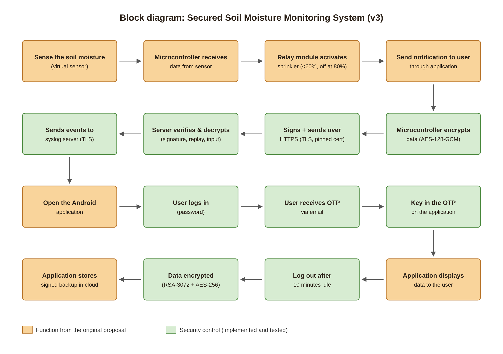
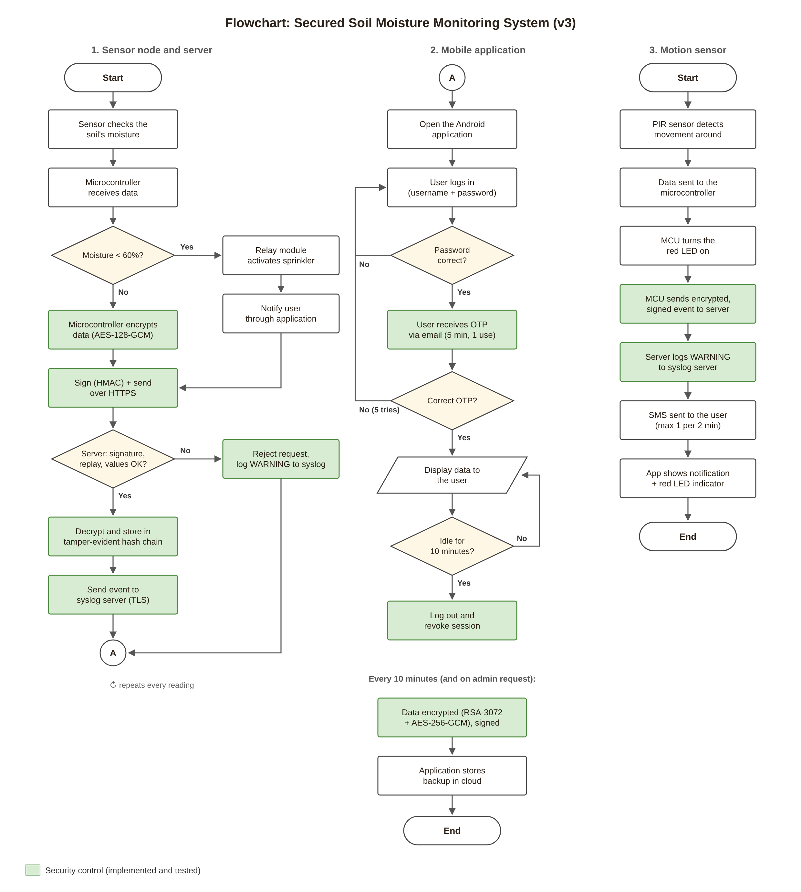

# Secured Soil Moisture Monitoring System (v3)

An automatic watering system for celery with security built in end to end. It started as my
2021–2022 final year project, which had to be done online during the PKP lockdown. This version
implements the full design from the original proposal (block diagram and flowcharts), and moves
the weak parts up to current standards.

The IoT hardware (soil sensor, relay/sprinkler, PIR motion sensor, LED) is simulated in software.
Everything else is real: encryption, the server, the mobile app, email OTP, syslog, SMS alerts
and encrypted cloud backups.



## Proposal vs. what's built

| Proposal (2021) | v3 implementation | Status |
|---|---|---|
| Sense the soil moisture | Virtual sensor with an evaporation model (faster in daytime sun) and sensor noise | Done |
| Microcontroller receives data | Virtual node runs the firmware loop: read → decide → send | Done |
| Relay activates sprinkler when moisture is low (≤ 24.5 mm) | Sprinkler on below 60%, off at 80% (hysteresis, so the relay doesn't flicker). Thresholds editable by admin. The proposal's mm value was changed to %, which is what capacitive sensors report | Done |
| Send notification to user through application | Server creates an alert when the sprinkler turns on; the app shows it and raises a phone notification | Done |
| Microcontroller encrypts data (symmetric) | **AES-128-GCM** per-device key (as proposed), plus an HMAC-SHA256 signature, timestamp and one-time nonce | Done |
| Microcontroller sends data to application through Wi-Fi | HTTPS (TLS 1.2+) with the server certificate pinned on the device | Done |
| Application receives and decrypts the data | Server verifies signature → blocks replays → decrypts → validates values → stores in a tamper-evident hash chain | Done |
| Sends data to syslog server | Every reading and security event sent to a central syslog server in **RFC 5424** format over **TLS (RFC 5425, port 6514)** | Done |
| Open the Android application | React Native (Expo) app for Android and iPhone | Done |
| User logs in | Username + password (scrypt hashed, rate limited, no username enumeration) | Done |
| User receives OTP via email | 6-digit code by email, expires in 5 minutes, works once, stored hashed | Done |
| Key in the OTP / Correct OTP? No → back | 5 wrong codes kills the attempt and sends the user back to the login step | Done |
| Application displays data to the user | Live moisture, sprinkler state, chart, water used, notifications, motion LED | Done |
| Log out after 10 minutes | Enforced on the server **and** in the app. Background refreshes don't count as activity | Done |
| Data gets encrypted (asymmetric, RSA-1024) | **RSA-3072-OAEP + AES-256-GCM** hybrid encryption, signed with Ed25519. Upgraded because RSA-1024 is no longer considered safe | Done (upgraded) |
| Application sends and stores data in cloud | Encrypted backups every 10 minutes (and on demand) to a cloud folder (stands in for S3). The server only holds the public key; the private key is kept offline | Done |
| PIR sensor detects movement | Virtual PIR sensor (random visitors, or press `m` to trigger) | Done |
| Arduino sends data to the syslog server | Motion event encrypted + signed to the server, logged as a syslog WARNING | Done |
| GSM module sends an SMS to the user (later: LED lights up) | Both: red LED on the device and in the app, plus an SMS to the admin (rate limited to 1 per 2 minutes) | Done |

Extra security that wasn't in the proposal: replay protection, certificate pinning, signed
commands back to the device, role-based access (admin / viewer), CSRF and XSS protection,
tamper-evident hash chain with an integrity check, audit log, anomaly flags, and a red-team
script that tests all of it.



## Results

All results below are from real runs, saved in `docs/results/` and `docs/screenshots/`.

**Attack tests:** `npm run attack -- --tamper-db` gives **19 blocked/detected, 0 got through**:

| # | Attack | Result |
|---|---|---|
| 1 | Fake reading with no signature | 401 blocked |
| 2 | Fake reading signed with a wrong key | 401 Bad signature |
| 3 | Eavesdropper reads a captured reading | Only ciphertext visible (AES-128-GCM) |
| 4 | Encrypted reading modified in transit | 401 Bad signature |
| 5 | Unencrypted payload with a valid signature | 400 Payload must be encrypted |
| 6 | Replay of a captured valid request | 409 Replay detected |
| 7 | Request captured 5 minutes ago | 401 Timestamp too old |
| 8 | SQL injection in device ID | 401 Unknown device |
| 9 | Out-of-range value (moisture 450%) | 400 Invalid payload |
| 10 | Fake motion alert to spam the owner with SMS | 401 Bad signature |
| 11 | Oversized payload (5 KB) | 413 Payload too large |
| 12 | Read data without logging in | 401 Please log in |
| 13 | Reuse an OTP code that was already used | 401 Code already used |
| 14 | Viewer sets thresholds to 10–15% | 403 Only admin |
| 15 | Viewer downloads a backup | 403 Admin only |
| 16 | CSRF request | 403 Missing CSRF header |
| 17 | Stolen password, guessing the OTP | 401 locked after 5 tries, back to login |
| 18 | Brute-force password | 429 Too many failed attempts |
| 19 | Reading edited directly in the database | Detected: "Record content was modified" |

**Other tests**
- `idle-logout-test.txt`: session ends after the idle limit, even while the app keeps polling.
- `restore-output.txt`: backup signature valid, RSA unwrap OK, AES-GCM tag OK, SHA-256 match, chain intact.
- `syslog-output.txt`: readings (INFO), motion and rejected requests (WARN), tampering (CRIT).
- `email-otp-sample.txt`, `sms-alert-sample.txt`: the OTP email and motion SMS as sent.
- `device-output.txt`: a full watering cycle (on below 60%, off at 80%) and a motion event.

**Screenshots** (`docs/screenshots/`): login with OTP, wrong OTP, admin home with motion alert,
viewer (read-only), admin after the attack run (tampering detected), and the web dashboard.

## Run it

Needs Node.js 22.13+ and OpenSSL. No npm install needed for the server unless you want real email.

```bash
npm run setup     # keys, TLS cert, database, device, users (prints passwords)
npm run syslog    # terminal 1: syslog server (TLS, port 6514)
npm run server    # terminal 2: HTTPS API + web dashboard on https://localhost:8443
npm run device    # terminal 3: virtual sensor node (type "m" + Enter for motion)
npm run attack -- --tamper-db   # terminal 4: red-team tests
npm run restore   # decrypt the newest cloud backup with the offline private key
npm run reset     # wipe everything and start fresh
```

Login is password + 6-digit email code. Without SMTP settings the emails and SMS are written
to `outbox/` so the demo works offline. For real email (e.g. Gmail with an App Password):

```bash
npm install
SMTP_HOST=smtp.gmail.com SMTP_PORT=465 SMTP_USER=you@gmail.com SMTP_PASS=app-password \
ADMIN_EMAIL=you@gmail.com npm run reset   # setup uses ADMIN_EMAIL for the admin account
SMTP_HOST=smtp.gmail.com SMTP_PORT=465 SMTP_USER=you@gmail.com SMTP_PASS=app-password npm run server
```

### Mobile app

```bash
cd mobile
npm install
npx expo start    # scan the QR code with Expo Go
```

The phone must trust the server's certificate. Easiest for a demo is a Cloudflare quick tunnel:

```bash
cloudflared tunnel --url https://localhost:8443 --origin-ca-pool certs/server.crt
```

Put the printed `https://….trycloudflare.com` address in the app's Server URL field. On an
iPhone you can instead install `certs/server.crt` as a trusted profile and use the Wi-Fi address
from `CREDENTIALS.txt`. For production, build the app (`npx expo run:android` / EAS) and pin
the key in `certs/spki-pin.txt`.

Notifications in Expo Go are local notifications raised while the app is open. Alerts while
the app is fully closed need remote push (a development build plus Expo push / FCM).

## Architecture

```
 Virtual IoT node                      Server (Node.js, HTTPS)                 Syslog server
 ┌───────────────────┐  AES-128-GCM    ┌─────────────────────────────┐ TLS   ┌──────────────┐
 │ soil sensor       │  + HMAC + nonce │ verify signature / replay   │──────►│ RFC 5424     │
 │ relay / sprinkler │────────────────►│ decrypt, validate           │ 6514  │ logs/        │
 │ PIR + LED         │◄────────────────│ hash-chain storage (SQLite) │       └──────────────┘
 └───────────────────┘ Ed25519-signed  │ alerts, audit log           │──► SMS / email (outbox or SMTP)
                        thresholds     │ OTP login, 10-min sessions  │
 ┌───────────────────┐  HTTPS + token  │ backup: RSA-3072 + AES-256  │──► cloud/ (encrypted)
 │ Mobile app (Expo) │◄───────────────►│                             │
 └───────────────────┘                 └─────────────────────────────┘
```

## Security design (summary)

- **Device → server:** per-device 256-bit secret, split with HKDF into an AES-128 encryption key and
  an HMAC key. Encrypt-then-sign. Timestamps (±30 s) and one-time nonces stop replays. TLS with a
  pinned certificate stops man-in-the-middle. Device keys are stored encrypted (AES-256-GCM) in the DB.
- **Server → device:** thresholds signed with Ed25519 and tied to the request nonce, so a fake
  server can't flood or starve the plant.
- **Users:** scrypt passwords, email OTP (hashed, 5-minute expiry, single use, 5 tries), rate limiting,
  random session tokens stored only as SHA-256 hashes, 10-minute idle and 8-hour absolute timeouts,
  server-side logout. Roles enforced on the server.
- **App:** HTTPS only, token in Keychain / Android Keystore (`expo-secure-store`), password never stored,
  idle logout, Android backups disabled.
- **Data at rest:** HMAC hash chain with a signed head pointer catches edits, deletions and reordering.
- **Backups:** hybrid RSA-OAEP-3072 + AES-256-GCM, signed, private key offline.
- **Monitoring:** audit table + syslog over TLS; alerts for sprinkler, motion and tampering.

## Limitations (honest list)

- Hardware is simulated. On a real ESP32 the device key belongs in a secure element or flash
  encryption, and the same HTTPS + AES + HMAC code works with mbedTLS.
- Server secrets are in a file; production should use a secrets manager / KMS.
- `cloud/` is a local folder standing in for S3; uploading the same files to S3 is a small change.
- SMS goes to `outbox/`; production needs an SMS gateway or GSM modem.
- Email OTP is weaker than an authenticator app or passkeys; it matches the proposal.
- Rate limits are in memory and reset on restart.

## Files

```
setup.js                 keys, cert, DB, users, backup key pair
shared/lib.js            AES-128-GCM, HMAC signing, HKDF, HTTPS client
server/server.js         API, OTP login, sessions, alerts, validation, hash chain
server/syslog.js         RFC 5424 over TLS client
server/notify.js         email (SMTP or outbox) and SMS
server/backup.js         RSA-3072 + AES-256-GCM signed backups
server/public/           web dashboard
device/simulator.js      virtual soil sensor, sprinkler, PIR, LED
tools/syslog-collector.js  syslog server
tools/restore-backup.js  decrypt + verify a backup
attacks/attack.js        19 red-team tests
mobile/                  React Native app (Expo)
docs/                    diagrams, screenshots, test results
```
