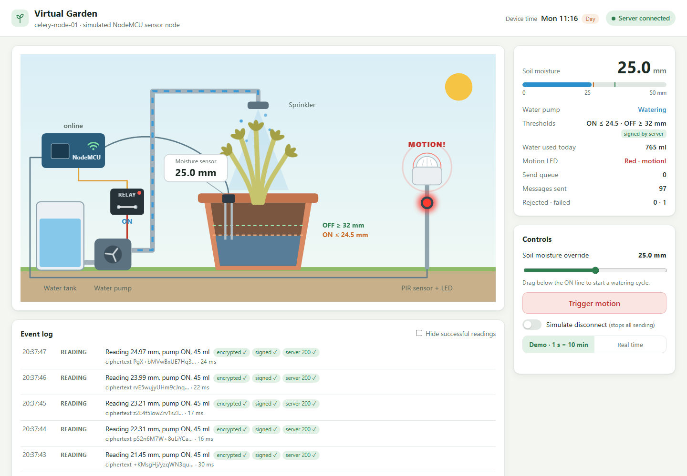
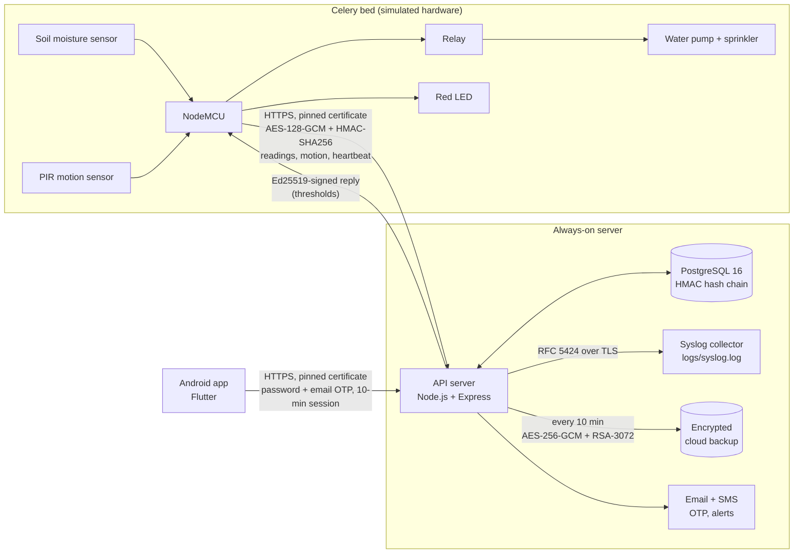
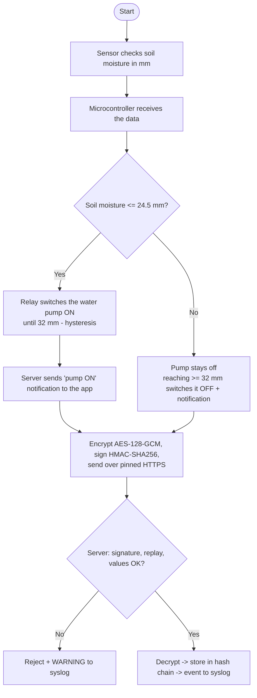
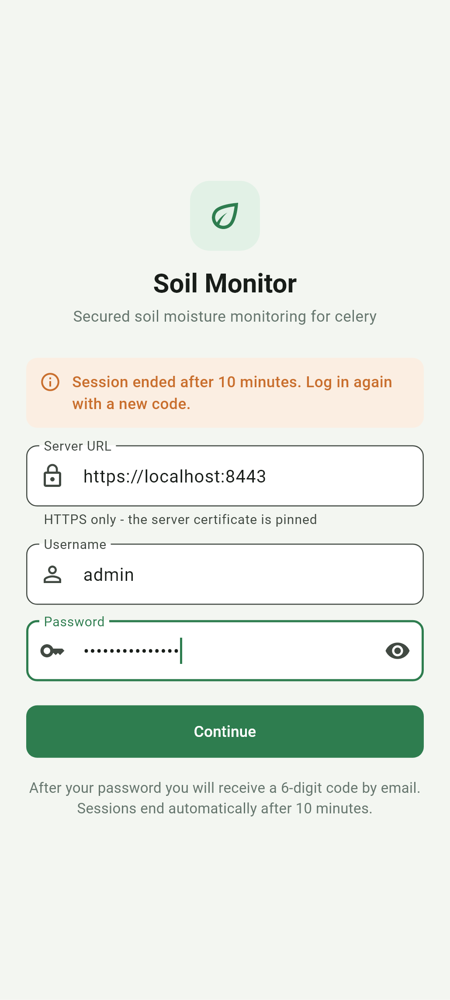
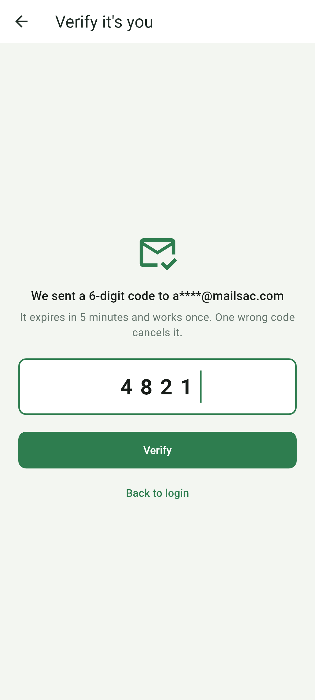
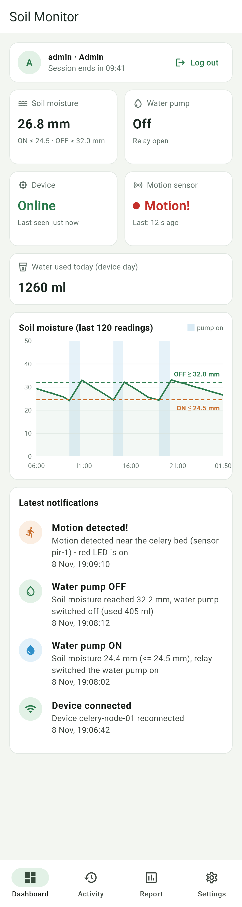
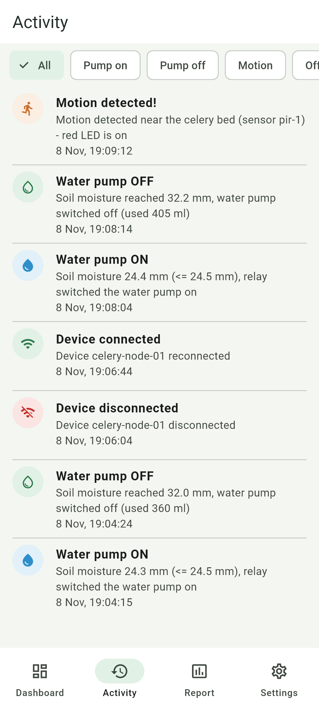
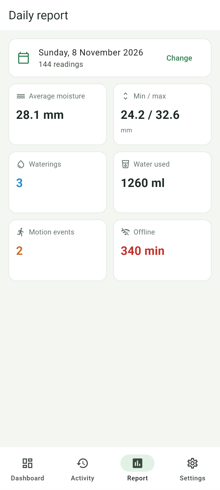
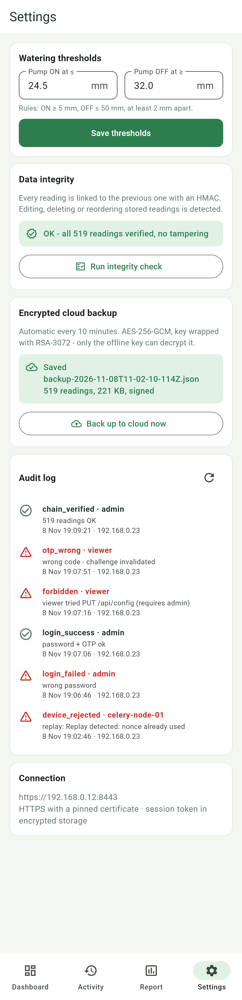

# Secured Soil Moisture Monitoring System

[](https://github.com/danishharraz01/Secured-Soil-Moisture-Monitoring-System/actions/workflows/ci.yml)


An automatic watering system for **celery** that measures soil moisture (in mm),
switches a water pump through a relay, watches the plot with a motion sensor and
reports everything to an Android app - with security designed in from the
sensor to the cloud backup.

<p align="center">
  
</p>

## Why this project exists

This was my **Diploma final year project (2021-2022)**. It was done online during
the PKP/MCO lockdown in Malaysia, so I could not build the hardware - the
NodeMCU, sensors and pump were only simulated, and the end result was not what I
had designed in my proposal.

This repository is the **portfolio rebuild**: the same system, following my
original block diagram and flowcharts, but finished properly - a working
end-to-end system, security upgraded to current standards, automated tests,
an attack script that tries to break it, and CI. The hardware is still
simulated, but now by a faithful virtual device with a live "Virtual Garden"
view instead of a mock-up.

---

## Contents

[Architecture](#architecture) ·
[How it works](#how-it-works-the-four-flows) ·
[Run it](#run-it) ·
[Using it](#using-it) ·
[Proposal vs. implementation](#proposal-vs-implementation) ·
[Security controls](#security-controls) ·
[Tests and results](#tests-and-results) ·
[Limitations](#honest-limitations) ·
[Project layout](#project-layout)

## Architecture



| Part                                       | Folder                 | Technology                                                                           |
| ------------------------------------------ | ---------------------- | ------------------------------------------------------------------------------------ |
| Virtual IoT device + "Virtual Garden" page | [`device/`](device/)   | Node.js, TypeScript, Express, Server-Sent Events, SVG                                |
| API server                                 | [`server/`](server/)   | Node.js, TypeScript, Express 5, PostgreSQL 16, Prisma 7, zod, pino                   |
| Syslog collector                           | [`syslog/`](syslog/)   | Node.js TLS server, RFC 5424 + RFC 6587 octet counting                               |
| Android app                                | [`app/`](app/)         | Flutter, `http`, `flutter_secure_storage`, `fl_chart`, `flutter_local_notifications` |
| Attack script                              | [`attacks/`](attacks/) | TypeScript red-team script                                                           |
| Shared crypto + protocol                   | [`shared/`](shared/)   | HKDF, AES-GCM, HMAC, Ed25519 reply check, syslog framing                             |

Everything uses Node's built-in `crypto` (OpenSSL) - there is no home-made cryptography.

## How it works (the four flows)

**Flow 1 - sensor node.** Every tick the sensor reads the soil (mm). The
microcontroller itself decides: **≤ 24.5 mm → relay switches the pump ON**; it
keeps watering until **32 mm** (hysteresis, prevents waterlogging) and then
switches OFF. The decision runs on the device, so the plant is still watered if
the server is down. Each reading is encrypted (AES-128-GCM), signed
(HMAC-SHA256) and sent over HTTPS with the server certificate pinned. The server
checks signature, replay and values, decrypts, stores the reading in a
tamper-evident hash chain and logs it to syslog; pump ON/OFF changes become app
notifications ("relay switched the water pump on" / "… switched off (used 405 ml)").

**Flow 2 - Android app.** Login with username + password → a 6-digit code is
emailed → a correct code opens the dashboard; **one wrong code cancels it and
sends you back to login**. The session ends **10 minutes after login** (no
extension) and a new code is needed. Every 10 minutes - and on admin request -
all data is encrypted (AES-256-GCM, key wrapped with RSA-3072-OAEP), signed and
stored in the cloud folder.

**Flow 3 - physical security.** The PIR sensor detects movement → the red LED
turns on → an encrypted, signed motion event goes to the server → syslog
WARNING → SMS + email to the owner (max 1 per 2 minutes) → app notification.

**Flow 4 - disconnection.** The device sends a signed heartbeat every 10 s. No
heartbeat for 30 s → the device is marked **offline** → syslog CRIT, SMS + email
→ the app shows "Device disconnected". When heartbeats return: "Device
reconnected" (syslog NOTICE).

<details>
<summary>Flow 1 as a flowchart (matches the proposal)</summary>



</details>

## Run it

**Requirements:** Node.js 22+ (24 recommended). Docker is optional - without it
an embedded PostgreSQL 16 is downloaded through npm. Flutter 3.47+ and an
Android emulator/phone for the app.

```bash
git clone https://github.com/danishharraz01/Secured-Soil-Moisture-Monitoring-System.git
cd Secured-Soil-Moisture-Monitoring-System
npm install
npm run demo                 # first run also runs `npm run setup`
```

`npm run demo` starts PostgreSQL (already running → Docker Compose → embedded,
in that order), applies migrations, and runs the syslog collector, API server
and virtual device together. It prints where everything is:

```text
  Virtual Garden     http://localhost:4000
  API server         https://localhost:8443   phone on Wi-Fi: https://192.168.0.12:8443
  Syslog collector   tls://localhost:6514 -> logs/syslog.log
  Log in             usernames + passwords in CREDENTIALS.txt
  OTP code           newest outbox/email-*.txt (no SMTP configured)
  Android emulator   adb reverse tcp:8443 tcp:8443  then use https://localhost:8443
  Try to break it    npm run attack   (in another terminal)
```

Optional, in another terminal: `npm run seed -- --fresh` loads 24 hours of
realistic history so the chart, activity list and report are full.

**The app:** `cd app && flutter run` (see [app/README.md](app/README.md)).
On an emulator run `adb reverse tcp:8443 tcp:8443` and use
`https://localhost:8443`. The passwords are in `CREDENTIALS.txt`; the email code
is in the newest `outbox/email-*.txt` (or your inbox if `SMTP_*` is set in `.env`).

<details>
<summary>All commands</summary>

| Command                                       | What it does                                                                          |
| --------------------------------------------- | ------------------------------------------------------------------------------------- |
| `npm run demo`                                | Everything in one terminal (Ctrl+C stops all of it cleanly)                           |
| `npm run setup`                               | Idempotent: `.env`, TLS certificate, keys, database, device, users, `CREDENTIALS.txt` |
| `npm run reset`                               | Wipes data, keys and certificates, then runs setup again                              |
| `npm run seed [-- --fresh]`                   | 24 h of readings + alerts (`--fresh` keeps users and keys)                            |
| `npm run db` / `syslog` / `server` / `device` | Run one part on its own                                                               |
| `npm run restore [file]`                      | Verify and decrypt a cloud backup with the offline key                                |
| `npm run attack [-- --tamper-db]`             | Red-team script against the running server                                            |
| `npm test`                                    | Unit + integration tests (uses `TEST_DATABASE_URL`, never the dev database)           |
| `npm run typecheck` / `lint` / `format:check` | Static checks                                                                         |

</details>

## Using it

### Virtual Garden - http://localhost:4000

A live view of the simulated hardware (local only, `127.0.0.1`): the celery pot
in cross-section with the soil water level rising and falling, the probe with
its reading, the relay that visibly switches, the pump and water flowing to the
sprinkler, the 24.5 / 32 mm lines, the PIR sensor and red LED, and the Wi-Fi
status of the NodeMCU. Day and night follow the device clock.

- **Soil moisture slider** - drag below the ON line to force a watering cycle.
- **Trigger motion** - PIR event: LED red for 60 s, encrypted event, SMS + email.
- **Simulate disconnect** - stops all sending; after 30 s the server marks the
  device offline. The pump keeps working locally.
- **Speed** - demo (1 s = 10 min) or real time.
- **Event log** - every message shows `encrypted ✓ signed ✓ server 200 ✓`
  with the start of the ciphertext, or the exact error.

### Android app

| Login                                                                       | One-time code                                                           | Dashboard                                                                    |
| --------------------------------------------------------------------------- | ----------------------------------------------------------------------- | ---------------------------------------------------------------------------- |
|  |  |  |

| Activity                                                                   | Daily report                                                                 | Settings (admin)                                                           |
| -------------------------------------------------------------------------- | ---------------------------------------------------------------------------- | -------------------------------------------------------------------------- |
|  |  |  |

- **Dashboard** - session countdown and log out, soil moisture, pump, device
  online/offline, motion sensor (red dot for 60 s after motion), water used
  today, a 0-50 mm chart with the thresholds dashed and watering periods
  shaded, the latest notifications. Refreshes every 3 s; pull to refresh.
- **Activity** - pump on/off, motion and offline/online history with filters.
- **Report** - average/min/max moisture, waterings, water used, motion events
  and offline minutes for any day.
- **Settings** - thresholds (admin edits, viewer read-only), **Run integrity
  check** (green OK or red "Tampering detected at reading #N"), **Back up to
  cloud now** and the audit log with suspicious actions in red (admin).
- New alerts arrive as Android notifications ("Plant alerts" channel).

App screenshots are rendered from the real app widgets with sample data
(`flutter test test_screenshots --update-goldens`).

## Proposal vs. implementation

| Proposal (2021/22)                                                | This implementation                                                            | Status       |
| ----------------------------------------------------------------- | ------------------------------------------------------------------------------ | ------------ |
| NodeMCU reads a soil moisture sensor                              | Virtual NodeMCU with sensor physics (evaporation by day/night, ±0.12 mm noise) | ✅ simulated |
| Relay switches the water pump + sprinkler at a moisture threshold | Pump ON ≤ 24.5 mm, OFF ≥ 32 mm (hysteresis), decided on the device             | ✅           |
| Notify the owner when the pump turns on/off                       | App notifications with the moisture value and water used                       | ✅           |
| PIR motion sensor + LED for physical security                     | PIR event → red LED 60 s → syslog WARNING → SMS + email → app                  | ✅ simulated |
| Encrypt the sensor data                                           | AES-128-GCM per message, keys derived with HKDF from a 256-bit device secret   | ✅ upgraded  |
| Login with password + OTP by email                                | scrypt passwords, 6-digit OTP (HMAC-stored, 5 min, single use)                 | ✅           |
| Logged out every 10 minutes                                       | Hard 10-minute session limit + countdown in the app                            | ✅           |
| Encrypted cloud backup every 10 minutes                           | AES-256-GCM + RSA-3072-OAEP, Ed25519-signed, keeps newest 20                   | ✅ upgraded  |
| Syslog server for security events                                 | RFC 5424 over TLS (RFC 5425), octet counting, 4 severities                     | ✅ upgraded  |
| SMS alerts through a GSM module                                   | SMS interface (outbox files, Twilio-ready) + email                             | ✅ interface |
| Android app to monitor the plant                                  | Flutter app: dashboard, chart, activity, report, settings                      | ✅           |
| Detect device disconnection                                       | Heartbeat every 10 s, offline after 30 s, CRIT + SMS/email                     | ✅           |

### Improvements over the proposal, and why

| Proposal                      | Now                                                               | Why                                                                                                                                                                                                       |
| ----------------------------- | ----------------------------------------------------------------- | --------------------------------------------------------------------------------------------------------------------------------------------------------------------------------------------------------- |
| RSA-1024/2048 encryption      | **RSA-3072-OAEP key wrap + AES-256-GCM** (hybrid)                 | NIST disallowed RSA-1024 in 2013 (≈80-bit security) and 2048-bit is only approved until 2030; 3072-bit ≈ 128-bit security (SP 800-57). RSA also cannot encrypt bulk data directly, so it wraps an AES key |
| The app acts as the hub       | **Always-on server**                                              | A phone is not always online; alerts, offline detection, backups and the audit trail need something that never sleeps                                                                                     |
| Unlimited OTP attempts        | **One wrong OTP cancels it; 5 failures / 5 min → 429 for 5 min**  | A 6-digit code can be brute-forced if guesses are unlimited                                                                                                                                               |
| Kiwi Syslog Server            | **Standard RFC 5424 over TLS with octet counting**                | Vendor-neutral (Kiwi, rsyslog, syslog-ng can receive it) and encrypted instead of plain UDP                                                                                                               |
| ownCloud folder               | **Encrypted, signed backups behind an S3-ready interface**        | The cloud provider never sees plaintext; only the offline key can decrypt; tampering is detected on restore                                                                                               |
| GSM module for SMS            | **SMS interface** (file outbox in development)                    | No modem needed for a demo; a provider like Twilio plugs into the same interface                                                                                                                          |
| Plain sensor messages         | **HMAC signature, timestamp ±30 s, single-use nonce, pinned TLS** | Stops forged, modified and replayed readings and man-in-the-middle attacks                                                                                                                                |
| Readings stored as plain rows | **HMAC hash chain + Ed25519-signed head**                         | Editing, deleting or reordering stored readings is detected                                                                                                                                               |

## Security controls

<details open>
<summary><b>Encryption</b></summary>

- Device → server payloads: **AES-128-GCM** (fresh 96-bit IV, device ID as AAD), keys from **HKDF-SHA256** of a 256-bit device secret.
- Transport: **TLS 1.2+ only** (1.0/1.1 and plain HTTP refused), ECDSA P-256 certificate.
- Device secret at rest: **AES-256-GCM** with the server master key, bound to the device ID.
- Backups: fresh **AES-256-GCM** data key, wrapped with **RSA-3072-OAEP-SHA256** using the public key only - the private key lives in `offline-keys/`.
- App token: `flutter_secure_storage` (Android Keystore-backed AES-GCM); `allowBackup="false"`.

</details>

<details>
<summary><b>Authentication</b></summary>

- Device: **HMAC-SHA256** over `METHOD\nPATH\nTIMESTAMP\nNONCE\nSHA256(BODY)`, compared in constant time.
- Users: **scrypt** (N=2^15, r=8, p=3, per-user salt), then a **6-digit email OTP** from `crypto.randomInt`, stored only as HMAC, valid 5 minutes, single use.
- Same generic error and the same scrypt work for unknown users and wrong passwords (no username enumeration).
- Server → device: replies **signed with Ed25519**, bound to the request nonce; the device ignores thresholds from any reply that fails.

</details>

<details>
<summary><b>Authorisation</b></summary>

- Roles enforced on the server: **viewer** reads, **admin** also changes thresholds, triggers backups and reads the audit log. Every 403 is audited.

</details>

<details>
<summary><b>Session management</b></summary>

- 32 random bytes, stored only as SHA-256. **Hard 10-minute limit** from login - no sliding renewal. 401 responses say why (`missing`, `invalid`, `expired`); logout deletes the session; the app deletes its token at 00:00 or on any 401.

</details>

<details>
<summary><b>Integrity</b></summary>

- Readings form an **HMAC hash chain**; the head (last id, hash, count) is **signed with Ed25519** so deleting the newest rows is also detected. `/api/verify` walks the chain; tampering raises a critical alert and syslog CRIT once.
- Backups carry a SHA-256 of the plaintext and an Ed25519 signature; restore re-checks every reading's HMAC.

</details>

<details>
<summary><b>Replay and man-in-the-middle protection</b></summary>

- Timestamp window ±30 s + single-use 128-bit nonce (stored 10 min) → replays get **409**.
- **Certificate pinning** in the device (`ca` = only the server certificate), the app (`SecurityContext(withTrustedRoots: false)`) and the syslog client. TLS verification is never disabled.

</details>

<details>
<summary><b>Input validation</b></summary>

- Device checks in a fixed order: device ID format → timestamp → nonce → signature → replay → **must be encrypted** → decrypt → **zod** schema (moisture 0-50 mm, strict objects, sizes). Body limit 2 KB.
- Every API query and body validated with zod; JSON only (415 otherwise); 10 KB limit; Prisma parameterised queries.
- Syslog values escaped (RFC 5424) and newlines stripped - no log injection.

</details>

<details>
<summary><b>Abuse protection</b></summary>

- 5 failed logins/OTPs per IP within 5 minutes → **429 for 5 minutes**.
- One wrong OTP invalidates it. Owner SMS/email at most once per 2 minutes per alert type.
- Virtual Garden: localhost only, Host-header check (DNS rebinding), Origin + JSON checks (CSRF), strict CSP.

</details>

<details>
<summary><b>Logging and monitoring</b></summary>

- Every security event → **Audit table + syslog** (WARNING: rejected/failed/blocked/forbidden/anomaly/otp_wrong; CRIT: tampering/offline; NOTICE otherwise). Daily report line at (simulated) midnight.
- The server queues up to 2000 syslog messages while the collector is down and reconnects every 5 s.
- Application logs (pino) never contain passwords, tokens, keys or OTP codes (verified by scanning the logs).
- API responses: HSTS, `nosniff`, `X-Frame-Options: DENY`, `Referrer-Policy: no-referrer`, `Cache-Control: no-store`, `CSP default-src 'none'`; no stack traces to clients.

</details>

<details>
<summary><b>Backup and recovery</b></summary>

- Encrypted, signed backup every 10 minutes + on demand; newest 20 kept.
- `npm run restore`: Ed25519 signature → unwrap with the offline RSA key → AES-GCM tag → SHA-256 → hash chain; writes `restored/` and prints a summary. Any modified byte → refused.

</details>

## Tests and results

| What                                                    | Result                                    | Output                                                           |
| ------------------------------------------------------- | ----------------------------------------- | ---------------------------------------------------------------- |
| Node unit + integration tests (vitest, real PostgreSQL) | **190 passed**                            | [docs/results/tests.txt](docs/results/tests.txt)                 |
| Flutter unit + widget tests                             | **20 passed**, `flutter analyze` clean    | [docs/results/flutter-tests.txt](docs/results/flutter-tests.txt) |
| Attack script `npm run attack -- --tamper-db`           | **21 attacks, 21 blocked, 0 got through** | [docs/results/attack.txt](docs/results/attack.txt)               |
| Backup restore                                          | 6/6 checks passed                         | [docs/results/restore.txt](docs/results/restore.txt)             |
| Syslog (raw RFC 5424 lines)                             | CRIT / WARNING / NOTICE / INFO            | [docs/results/syslog-sample.txt](docs/results/syslog-sample.txt) |

The tests cover: AES-GCM round trip and tamper detection, HKDF/HMAC test
vectors (RFC 5869, RFC 4231), the pump hysteresis (ON at ≤ 24.5, OFF at ≥ 32),
OTP rules (expiry, single use, one wrong → invalid), the 10-minute session
limit, hash chain verification (edit / delete / reorder / deleted tail /
forged head), backup seal + restore, certificate pinning over real TLS, the
syslog collector (queue → reconnect → flush), and full flows: login with OTP,
accepted reading, tampered reading, replay 409, viewer 403, offline detection.

```text
 7. BLOCKED     Replay of a captured valid request
    HTTP 409 Replay detected: nonce already used (original: HTTP 200)
 6. BLOCKED     Unencrypted payload with a VALID signature
    HTTP 400 Payload must be encrypted
20. BLOCKED     Edit a reading directly in PostgreSQL (--tamper-db)
    before: ok=true; reading #322 set to 49.9 mm -> /api/verify: "Reading #322 was modified"; value restored -> ok=true
21. BLOCKED     Brute-force the admin password
    locked out after 5 wrong passwords: HTTP 429, Retry-After 300 s

21 attacks: 21 blocked, 0 got through
```

CI ([`.github/workflows/ci.yml`](.github/workflows/ci.yml)) runs type checks,
lint, formatting and all tests against a PostgreSQL 16 service, then starts the
server and runs the attack script (the build fails if anything gets through),
plus `flutter analyze` and `flutter test`.

## Honest limitations

- **Hardware is simulated.** The device, sensor physics, relay, pump and PIR are software; the protocol and security are real.
- **Secrets are files, not a KMS/HSM.** Keys live in `server/keys/` and `offline-keys/` (gitignored). On Windows the `0600` permissions are not enforced; the user profile's ACL protects them instead. A production system would use a key management service and keep the backup private key truly offline.
- **SMS and cloud are local in development.** SMS and (without SMTP) email are written to `outbox/`; backups go to `cloud/` through an S3-ready interface.
- **Email OTP is weaker than an authenticator app** (TOTP/WebAuthn): it depends on the security of the mailbox.
- **Self-signed, pinned certificate** instead of a public CA - fine for a closed system with its own clients; the certificate must be re-issued (`npm run reset`) if the server's IP changes.
- **Single server instance.** The brute-force limiter is in memory; several instances would need a shared store (Redis/DB).
- **Hash chain roll-back.** Someone with database access _and_ an old copy of the signed head could roll back readings and head together; the encrypted backups and the syslog trail make this visible.
- **Backups are full copies**, which is fine at this scale; a long-running system would back up incrementally.
- **The Android app** was verified with unit/widget tests, an APK build and rendered screenshots; there is no iOS build.

## Project layout

```text
device/    virtual NodeMCU, physics, pump controller, pinned HTTPS link, Virtual Garden page
server/    API (src/), Prisma schema + migrations (prisma/), setup/reset/seed/demo/restore (scripts/)
syslog/    TLS syslog collector
attacks/   red-team script
shared/    crypto, device protocol, constants, syslog format (used by all of the above)
app/       Flutter Android app
docs/      screenshots/ and results/ (real outputs)
.github/   CI workflow
```

---

**Author:** Danish Harraz - Diploma final year project (2021-2022), rebuilt for my portfolio.
